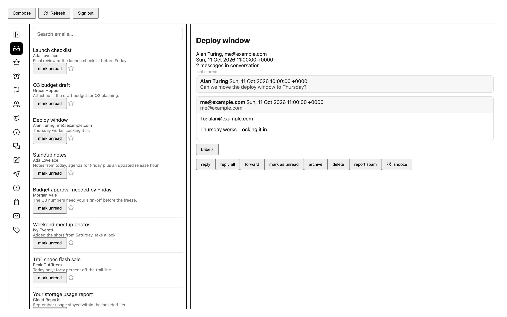

<!-- LOGO -->
<h1>
<p align="center">
  
  <br>mailsy
</h1>
  <p align="center">
    Fast, native, keyboard-friendly Gmail client for your desktop.
    <br />
    Read, search, snooze, and send mail — without the browser.
    <br />
    <a href="#about">About</a>
    ·
    <a href="#download">Download</a>
    ·
    <a href="#screenshots">Screenshots</a>
    ·
    <a href="#developing">Developing</a>
    ·
    <a href="#roadmap">Roadmap</a>
  </p>
</p>

## About

mailsy is a Gmail client that differentiates itself by being fast,
keyboard-friendly, and native. Webmail gives you every feature but weighs
you down with tabs, toolbars, and a slow, uncustomizeable experience.
mailsy gives you the mail you actually use in a small, quick desktop app.

mailsy is built with Electron, React, and TypeScript, and talks to the
Gmail API over OAuth — it requests only the `gmail.modify` scope and stores
your refresh token encrypted with your OS keychain. You can revoke access
any time from your [Google account security settings](https://myaccount.google.com/permissions).

## Download

Installers for macOS (Apple Silicon and Intel), Windows, and Linux
(AppImage and deb) are attached to the
[latest release](https://github.com/mailsyapp/mailsy/releases/latest).
Install, sign in with Google, and you're in.

<details>
<summary>macOS Gatekeeper</summary>

mailsy isn't notarized with an Apple Developer certificate, so the first
launch may be blocked with *"mailsy can't be opened because it is from an
unidentified developer."* Right-click **mailsy** in Applications and choose
**Open**, then **Open** again in the dialog — this only needs to happen
once. If that doesn't work:

```bash
xattr -d com.apple.quarantine /Applications/mailsy.app
```

</details>

## Screenshots




## Developing

mailsy is a standard Electron application. To build it yourself:

```bash
git clone https://github.com/mailsyapp/mailsy.git
cd mailsy
npm install
npm run dev
```

Google OAuth credentials are baked in at build time. For development,
create a `.env` in the repo root:

```
MAIN_VITE_GOOGLE_CLIENT_ID=<your client id>
MAIN_VITE_GOOGLE_CLIENT_SECRET=<your client secret>
```

To create your own: enable the Gmail API in the
[Google Cloud Console](https://console.cloud.google.com/), create an OAuth
client of type *Web application* with the authorized redirect URI
`http://127.0.0.1:<port>`, and use the client ID/secret from there.

```bash
npm run typecheck    # typecheck main and renderer
npm run build        # typecheck + production build
npm run build:mac    # macOS dmg
npm run build:win    # Windows installer
npm run build:linux  # Linux AppImage + deb
```

Releases are built automatically by GitHub Actions on every `v*` tag and
attached to the GitHub Release.

## Roadmap and Status

mailsy is stable and in daily use for real mail.

The high-level ambitious plan for the project, in order:

|  #  | Step                                                     | Status |
| :-: | -------------------------------------------------------- | :----: |
|  1  | Full Gmail sync — inbox, starred, snoozed, sent, drafts, spam, trash |   ✅   |
|  2  | Fuzzy search across senders, subjects, and bodies        |   ✅   |
|  3  | Compose, reply, reply-all, forward, with attachments     |   ✅   |
|  4  | Drafts with autosave and per-compose signature           |   ✅   |
|  5  | Snooze and label management                              |   ✅   |
|  6  | Multi-account support                                    |   ❌   |

## License

mailsy is distributed under the [AGPL-3.0-only](LICENSE) license.
