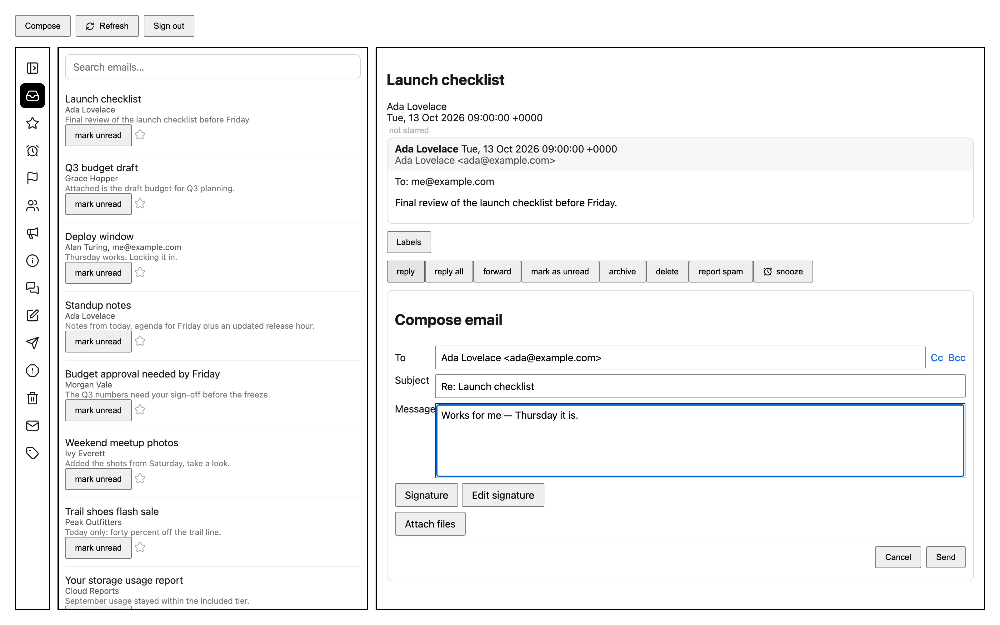

# mailsy

A fast, keyboard-friendly Gmail client for your desktop. Read, search, snooze, and send mail without the browser — built with Electron, React, and TypeScript.




## Features

- **Full Gmail sync** — inbox, starred, snoozed, sent, drafts, spam, and trash, kept up to date in the background
- **Search** — fuzzy search across senders, subjects, and bodies
- **Compose, reply, and reply-all** — with CC/BCC, inline images, and attachments
- **Drafts** — autosaved as you type, resumable across restarts
- **Snooze** — send mail away until a later time, and it comes back on its own
- **Labels & categories** — filter by any Gmail label or Social/Promotions/Updates category
- **Per-compose signature** — turn a signature on or off for each message
- **Keyboard-friendly** — quick reply/forward from the reading pane

## Platform support

| Platform | Installer | Status |
| --- | --- | --- |
| macOS (Apple Silicon) | `mailsy-<version>-arm64.dmg` | ✅ |
| macOS (Intel) | `mailsy-<version>-x64.dmg` | ✅ |
| Windows | `mailsy-<version>-setup.exe` | ✅ |
| Linux | `mailsy-<version>.AppImage` / `.deb` | ✅ |

Grab the latest installer for your platform from the [Releases page](https://github.com/mailsyapp/mailsy/releases). No build steps, no config — install, sign in with Google, and you're in.

## Install instructions

### macOS

1. Download the `.dmg` that matches your Mac (Apple Silicon or Intel) from the [Releases page](https://github.com/mailsyapp/mailsy/releases).
2. Open the `.dmg` and drag **mailsy** into **Applications**.
3. Launch it like any other app.

**Gatekeeper note:** mailsy isn't notarized with an Apple Developer certificate, so the first launch may be blocked with *"mailsy can't be opened because it is from an unidentified developer."* Right-click **mailsy** in Applications and choose **Open**, then **Open** again in the dialog — this only needs to happen once. If that doesn't work, run:

```bash
xattr -d com.apple.quarantine /Applications/mailsy.app
```

### Windows

1. Download `mailsy-<version>-setup.exe` from the [Releases page](https://github.com/mailsyapp/mailsy/releases).
2. Run the installer and follow the prompts.
3. If SmartScreen warns about an unrecognized publisher, choose **More info** → **Run anyway**.

### Linux

- **AppImage**: download it, `chmod +x mailsy-<version>.AppImage`, then run it.
- **Debian/Ubuntu**: `sudo dpkg -i mailsy-<version>.deb`.

## Sign in

mailsy signs in through Google's OAuth flow: it opens a local loopback listener, sends you to accounts.google.com in your browser, and stores the refresh token encrypted with your OS keychain (`safeStorage`). You can revoke access any time from your [Google account security settings](https://myaccount.google.com/permissions). mailsy requests only the `gmail.modify` scope — it can read, send, and organize your mail, but cannot delete labels or change account settings.

## Building from source

```bash
git clone https://github.com/mailsyapp/mailsy.git
cd mailsy
npm install
```

Google OAuth credentials are baked in at build time. For development, create a `.env` in the repo root:

```
MAIN_VITE_GOOGLE_CLIENT_ID=<your client id>
MAIN_VITE_GOOGLE_CLIENT_SECRET=<your client secret>
```

To create your own: enable the Gmail API in the [Google Cloud Console](https://console.cloud.google.com/apis/library/gmail.googleapis.com), create an OAuth client of type *Web application* with the authorized redirect URI `http://127.0.0.1:<port>` (the app uses an ephemeral loopback port, so any port works), and use the client ID/secret from there.

Then:

```bash
npm run dev          # development with hot reload
npm run build        # typecheck + production build
npm run build:mac    # macOS dmg
npm run build:win    # Windows installer
npm run build:linux  # Linux AppImage + deb
```

Releases are built automatically by GitHub Actions on every `v*` tag and attached to the GitHub Release.

## License

[AGPL-3.0-only](LICENSE)
